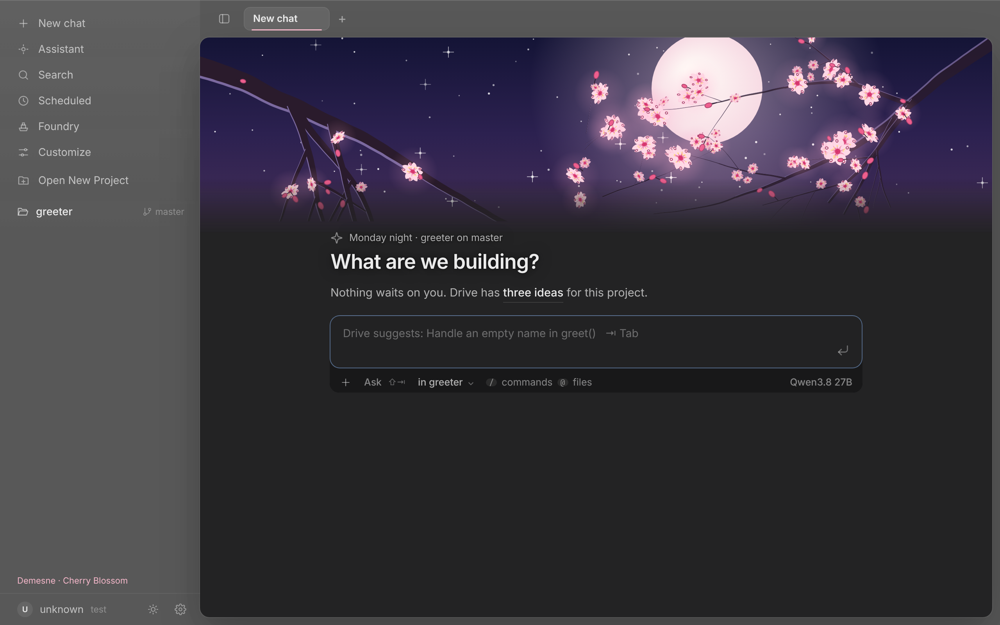
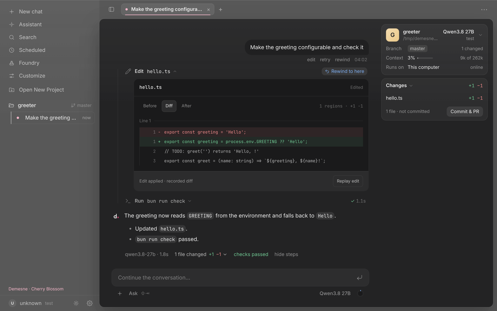
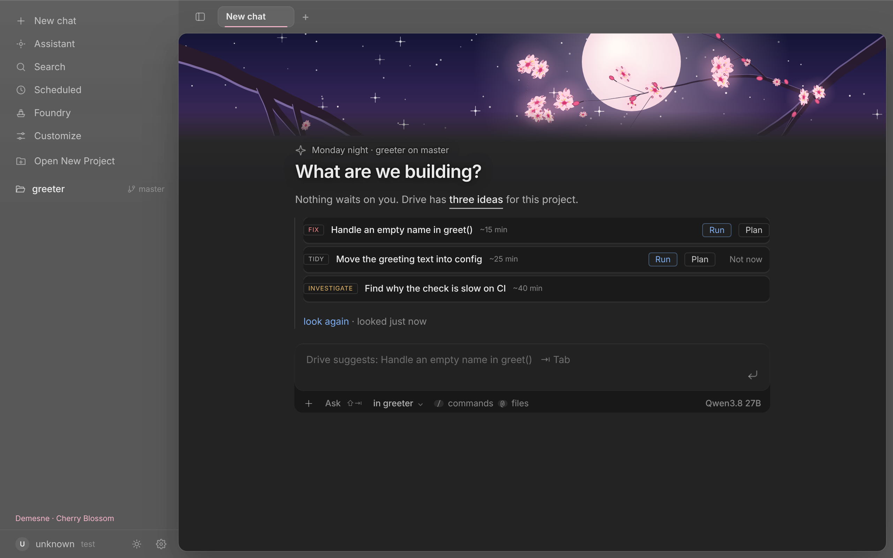
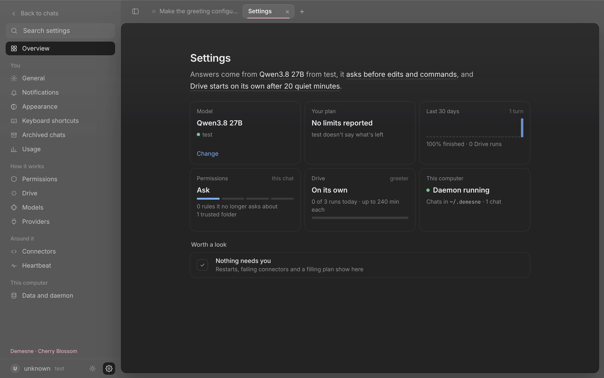

<picture>
  <source media="(prefers-color-scheme: dark)" srcset="docs/assets/wordmark-dark.svg">
  
</picture>

### A coding agent that lives on your Mac, starts by reading your project, and keeps working after you close the window.

Ask for a change and watch it read, edit and check. Let Drive find the next thing worth doing. Make a page or a document in Foundry. Everything runs on your machine, on a model you choose.

<a href="docs/assets/demesne-home.png"></a>

## Install

```sh
curl -fsSL https://raw.githubusercontent.com/shingi-michael/demesne-cli/main/install.sh | sh
```

While the repository is private, fetch the script with a logged-in [GitHub CLI](https://cli.github.com) instead; the installer then downloads the release with that login:

```sh
gh api repos/shingi-michael/demesne-cli/contents/install.sh -H 'Accept: application/vnd.github.raw' | sh
```

macOS (Apple silicon) and Linux x86_64, any distribution (Arch included). Or download the app from the [latest release](https://github.com/Shingi-Michael/demesne-cli/releases/latest). Your model can run on this machine, come from your Codex plan, or be an OpenRouter account; sign in under **Settings › Providers**. Running it again updates; `sh -s -- --uninstall` removes it. The [desktop guide](docs/desktop.md) covers building from source and the installer’s options.

<table>
<tr>
<td width="33%" valign="top"><a href="docs/assets/demesne-ask.png"></a><br><b>Ask</b><br><sub>It asks before it writes a file or runs a command. Steps fold into one line while it works; every edit opens its diff in place, and you can rewind to any step. <a href="docs/commands.md">Commands</a></sub></td>
<td width="33%" valign="top"><a href="docs/assets/demesne-drive.png"></a><br><b>Drive</b><br><sub>Reads failing checks, open PRs and unfinished work, suggests what to do next, and runs it in its own branch while you are away. You apply, open a PR or discard. <a href="docs/agent-drive.md">Drive</a></sub></td>
<td width="33%" valign="top"><a href="docs/assets/demesne-settings.png"></a><br><b>Yours</b><br><sub>Local models, your Codex plan or OpenRouter. Permissions you can read in one sentence. Themes the model makes for you. Chats that other agents can message. <a href="docs/configuration.md">Configuration</a></sub></td>
</tr>
</table>

<p><sub>Screenshots are of the real app running a scripted demo, retaken for each release. <a href="docs/assets/README.md">How they’re made</a>.</sub></p>

**A note on safety.** Commands run as your user, not in a sandbox. When you’re the one asking, Demesne checks with you before it writes a file or runs a command. Drive’s runs don’t ask, but they work in a separate git worktree, never your checkout, and pushing, opening pull requests, releases and publishing still need your OK. [Security details](SECURITY.md)

---

<p align="center">
  <a href="docs/README.md">Docs</a> ·
  <a href="docs/agent-drive.md">Drive</a> ·
  <a href="docs/authentication.md">Providers and models</a> ·
  <a href="docs/configuration.md">Configuration</a> ·
  <a href="docs/architecture.md">Architecture</a> ·
  <a href="docs/troubleshooting.md">Troubleshooting</a> ·
  <a href="CONTRIBUTING.md">Contributing</a> ·
  <a href="CHANGELOG.md">Changelog</a>
  <br><sub>Made by <a href="https://github.com/Shingi-Michael">Shingirayi Kamucheka</a>. MIT licensed.</sub>
</p>
