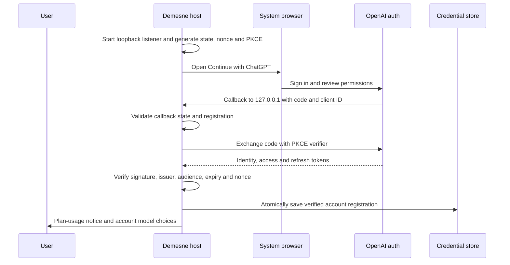

# Authentication and provider access

[Documentation index](README.md) · [Configuration](configuration.md) · [Security](../SECURITY.md)

## Two separate credentials

The desktop host authenticates to the local daemon with `daemon.token`. Providers have their own credentials. The desktop webview gets neither credential; the privileged host and daemon perform authenticated requests.

## Signing in and out in the app

**Settings › Providers** (or `/providers`, also `/login` and `/logout`) lists every configured provider with its state: Codex, ChatGPT and OpenRouter as signed in or out, local servers as needing no sign-in. Enter on a signed-out account opens its browser sign-in; on a signed-in one it signs out. A provider that isn't set up yet is listed too, and signing in adds it without replacing your primary provider. Each row says what pays: Codex uses your Codex plan, ChatGPT is metered as credits, OpenRouter uses its hosted models. Signing in to ChatGPT from this list is your acknowledgement that eligible requests are billed to your account, as the row says.

Signing out keeps the provider's configuration so signing back in is one step: Codex's tokens are deleted, ChatGPT's tokens are revoked and deleted (the account stays registered), and OpenRouter's key is removed from your config. The daemon then reloads its providers without a restart (`POST /v1/providers/reload`); a provider you're signed out of isn't offered. If it served the model you were using, demesne switches to another model, preferring one on your own machines, and says which.

## Codex: your Codex plan

The **Codex** provider talks to Codex's own backend (`https://chatgpt.com/backend-api/codex`) with Codex's own sign-in, so every request counts against your Codex plan the same way the Codex app does, with its 5-hour and weekly windows. It never spends credits. No Codex app or CLI is installed or read: Demesne carries the sign-in and the Responses adapter itself. Models are listed as `codex/<slug>` (for example `codex/gpt-6.1-sol`) from the plan's live catalog, with the thinking levels the catalog offers.

Sign in under **Settings › Providers**. Demesne starts a listener on `localhost:1455` (the port Codex's registration allows), opens the system browser on `auth.openai.com` with PKCE, and exchanges the callback code for tokens. The first Codex sign-in becomes your primary provider when you have none; otherwise it is added beside your other providers. If an earlier Demesne build left a managed Codex home at `<data_dir>/codex/auth.json`, its sign-in is carried over once and the old file is removed on sign-out.

Credentials live under `<data_dir>/auth/codex.json` with private permissions, atomic writes and a cross-process refresh lock; an access token is refreshed before it expires, and a rejected refresh signs you out. The config contains `auth = "codex"` and nothing else that identifies the account. Codex's issuer offers no revocation for this client, so sign-out is local. Plan usage comes back on every answer (the `x-codex-*` headers) and shows in the model picker; at the plan's limit Demesne says so and never switches billing on its own.

Implementation: [Codex sign-in](../packages/codex-auth/src/index.ts), [setup wiring](../packages/setup/src/codex-auth.ts), [Responses adapter](../packages/providers/src/chatgpt.ts) (the Codex route).

## Continue with ChatGPT

The **ChatGPT** provider connects directly to OpenAI's public Responses API through [Sign in with ChatGPT](https://developers.openai.com/siwc/token-sharing-open-source/sign-in) token sharing. Requests on this route are metered as credits on your account, not against the Codex plan; use **Codex** for plan billing. It can use `gpt-6.1-sol` with an eligible signed-in account. Demesne owns conversation context, tool execution and approvals; no separate coding-agent runtime is required.

Sign in under **Settings › Providers** or in first-run setup. Model choices come from the signed-in account's catalog, and the default is its first available item. Existing local providers are preserved by signing in from Settings; setup's Review makes the chosen provider primary. After connecting, select `/model gpt-6.1-sol`. A configured Sol choice remains available when the account's catalog omits it; inference still requires that account's access.

Demesne implements OpenAI's [local-app registration flow](https://developers.openai.com/siwc/token-sharing-open-source/sign-in). It persists a host identifier, uses dynamic registration for a new account, and reuses the issued client ID for a returning registration. A different verified identity cannot silently replace the selected registration. No other application's credential file is read.

The first plan-enabled login shows a usage acknowledgement. Tokens are saved after verified sign-in; the provider configuration is applied when setup Review is confirmed. Cancelling Review does not erase an already completed ChatGPT registration.

Credentials live under `<data_dir>/auth/chatgpt.json`, with private directory/file permissions, atomic writes, and a cross-process refresh lock. The config contains `auth = "chatgpt"` plus an `auth_profile` reference. Successful refreshes replace rotating credentials together. Terminal refresh failures require sign-in again. Logout clears local tokens and attempts refresh-token revocation; if remote revocation cannot be confirmed, the app says so. Registration identity remains available for later sign-in.

## ChatGPT inference behavior

Demesne uses the public [Responses API route for plan usage](https://developers.openai.com/siwc/token-sharing-open-source/models-and-inference), with `store: false`, `stream: true`, and locally supplied conversation history. OpenAI documents `gpt-6.1-sol` on this direct route. Demesne handles workspace tools and approvals. Function tools are namespaced. Completed streamed items are retained even when the terminal response's output array is empty; opaque reasoning is reused only with the matching account/model.

A completed stream is required before tools execute. Failed, incomplete, or disconnected streams remain failures. Eligible calls count against ChatGPT plan usage/credits; [Manage usage](https://chatgpt.com/settings/usage). There is no automatic API-key billing fallback.

Under the documented [preview limitations](https://developers.openai.com/siwc/token-sharing-open-source/preview-limitations), `max_output_tokens` is omitted from this route. In Demesne it is a local context reserve, not an enforced server output cap. Supported reasoning levels and summary support normally come from model metadata. A verified Sol entry uses its documented context and reasoning levels if the catalog supplies none. The adapter forwards the selected level and requests summaries only where supported. Image generation remains a separately configured backend.

Implementation: [OAuth package](../packages/chatgpt-auth/src/index.ts), [setup wiring](../packages/setup/src/chatgpt-auth.ts), [Responses adapter](../packages/providers/src/chatgpt.ts).

## Moving from ChatGPT to Codex

Sign in to **Codex** under Settings › Providers; when ChatGPT is your primary provider the new Codex entry sits beside it until you make it primary (`[provider]` with `auth = "codex"` in `config.toml`, or sign out of ChatGPT and sign in to Codex again). Transcripts recorded under ChatGPT keep their model labels; `codex/gpt-6.1-sol` is the same model on the plan route.

## OpenRouter and API keys

Signing in to OpenRouter uses a browser/PKCE key flow, or `OPENROUTER_API_KEY` if provided. Signing in writes a private provider configuration after validating the key/catalog. In setup, the key stays outside rendered state until Review writes it. The authenticated OpenRouter catalog supplies model metadata.

For another OpenAI-compatible endpoint, set its private `api_key` or the primary provider's `DEMESNE_API_KEY`. Model inference goes through Chat Completions. Supported reasoning controls vary by endpoint; an OpenAI-shaped API does not guarantee every optional field behaves identically.

Implementation: [OpenRouter auth](../packages/setup/src/openrouter-auth.ts), [provider adapter](../packages/providers/src/index.ts). See [troubleshooting](troubleshooting.md#chatgpt-sign-in-or-incomplete-tool-calls) for expired sessions and missing plan permissions.
