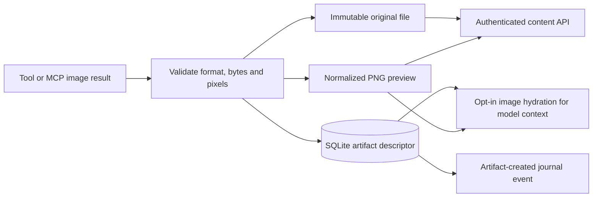

# Images

[Documentation index](README.md) · [Architecture](architecture.md) · [Configuration](configuration.md#images-and-mcp)

The daemon stores images that tools produce and can hand the latest two to a vision-capable model. The desktop window does not show them yet: its image panel went with the side panels. The data and routes below remain for the model, for history, and for a future inline view.

## Producers

The daemon ingests static PNG, JPEG and WebP images. Files are limited to 20 MiB and 40 million decoded pixels; multi-frame images and MIME/format mismatches are rejected. Original bytes are retained, and a normalized PNG preview fits within 1600 × 1600 without upscaling.

| Producer | What is available |
| --- | --- |
| MCP tools returning image content blocks | Structured ingestion with source/tool attribution |
| `view_image` | Import an image from the permitted workspace |
| `capture_window` | macOS window capture when the tool is registered and OS permission is available |
| `generate_image` | Generate or edit using a separately configured Images-compatible backend |

Enabling `vision`, image generation, or MCP servers registers the image path; `capture_window` is macOS-specific and needs OS screenshot permission. Generation credentials are separate from ChatGPT sign-in.

Storing an image does not give its pixels to the language model. With vision enabled, the latest two retained tool-image IDs in model context are resolved into image inputs at the provider boundary. Older images keep metadata; missing cached bytes fall back to text. The chat model, the image-generation model and the tool that captured a screenshot can all differ; keep those labels distinct when describing a result.

## Data flow



## Modules

| Responsibility | Implementation |
| --- | --- |
| Contracts | [ImageArtifact / ArtifactPage](../packages/protocol/src/index.ts) |
| Validation, content addressing, derivative encoding | [artifacts.ts](../apps/daemon/src/artifacts.ts) |
| Descriptor persistence and idempotent events | [storage](../packages/storage/src/index.ts) |
| Workspace image import and structured tool output | [tools.ts](../apps/daemon/src/tools.ts) |
| MCP image content normalization | [mcp.ts](../apps/daemon/src/mcp.ts) |
| macOS window capture | [window-capture.ts](../apps/daemon/src/window-capture.ts) |
| Images-compatible generation/edit requests | [image-generation.ts](../apps/daemon/src/image-generation.ts) |
| Last-two-image model inputs | [image-inputs.ts](../apps/daemon/src/image-inputs.ts) |
| Authenticated routes | [app.ts](../apps/daemon/src/app.ts) |
| Metadata/content client | [client](../packages/client/src/index.ts) |

## Ingestion and storage

`ImageOutput` contains bytes, declared MIME type, and optional filename/model/revision/viewport metadata. Structured tool results carry text plus images; string-only tools remain supported.

Sharp verifies PNG/JPEG/WebP, rejects animated/mismatched or oversized inputs, applies orientation, and creates a PNG preview up to 1600 pixels on either edge. Ingestion caps each input at 20 MiB/40 million pixels. MCP JSON-RPC image frames are separately bounded at 32 MiB; normal text results remain bounded.

Original and preview files use SHA-256 names under `artifacts/` beside the database. Writes use temporary files and rename, with owner-only permissions. SQLite stores the descriptor and a producer-output idempotency key based on tool-call ID/output index, preventing duplicate journal delivery from creating duplicate artifacts. Original image bytes are not embedded in model-message/event JSON.

Artifacts are session-scoped. The descriptor links to a recorded turn/tool and stores an explicit `revisionOf` only if the referenced artifact exists in that session. This is not arbitrary filesystem serving: client IDs resolve through metadata to the content-addressed files.

## HTTP contract

| Route | Behavior |
| --- | --- |
| `GET /v1/sessions/:id/artifacts?after=N&limit=N` | Cursor page, next cursor and event watermark; limit 1–100, default 50 |
| `GET /v1/sessions/:id/artifacts/:artifactId` | Session-scoped descriptor |
| `GET /v1/sessions/:id/artifacts/:artifactId/content?variant=preview` | PNG derivative; default variant |
| `GET /v1/sessions/:id/artifacts/:artifactId/content?variant=original` | Original bytes and MIME type |
| `POST /v1/sessions/:id/artifacts/import` | Import permitted workspace image; optional reference/viewport metadata |

All routes require production daemon authentication. Content responses include MIME type, length and ETag. Missing files return an unavailable/not-found response. Reference import requires a session with a workspace and existing turn. The [typed client](../packages/client/src/index.ts) is the source for request/response shapes.

## Model input and packaging

Vision hydration selects the last two retained image IDs in tool messages, resolves their previews, and adds data URLs only at the provider boundary. The engine reserves additional context for those image inputs. A missing file does not prevent text-only replay. Chat Completions and Responses serialize image inputs differently through their respective adapters.

Compiled daemons load native image dependencies beside the real executable, outside Bun's embedded filesystem. Keep `dist/node_modules` with `demesned`; building only the executable and omitting those codecs is incomplete packaging.

## Verification

```sh
bun test apps/daemon/test/artifacts.test.ts apps/daemon/test/image-inputs.test.ts apps/daemon/test/image-generation.test.ts
bun test packages/storage/test
```

Coverage includes immutable originals, MIME/size rejection, authenticated/session-scoped access, duplicate delivery, model hydration, replay and reference import. Tests with fake producers do not establish a live provider's model availability or image-generation entitlement.
