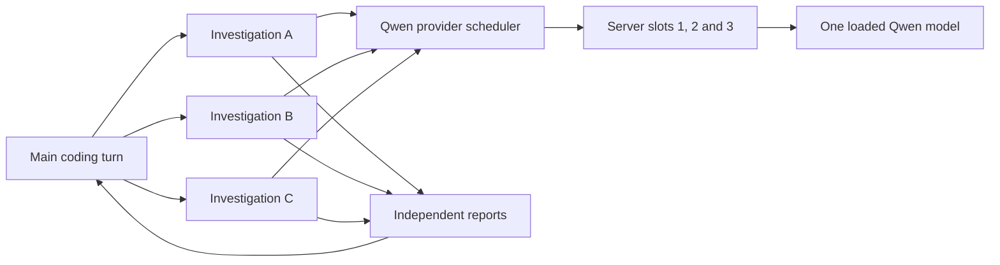

# Subagents and concurrency

[Documentation index](README.md) · [Configuration](configuration.md#multiple-providers-and-concurrency) · [Agent Drive](agent-drive.md)

## What a subagent is

The coding agent calls the `subagent` tool with a task label, a self-contained prompt, and optionally a configured model ID. Each invocation gets a fresh context. The parent receives its final report. In the app a sub-agent is one step on the turn's guide, like a read or a command: "Agent · task" with its step count on the right, and clicking it unfolds the sub-agent's own steps one level in (reads folded as Explored, searches and lists as lines) and what it found. Sub-agents run with thinking off, and no thinking of theirs is shown.

Allowed tools are `list_files`, `read_file`, `read_files`, `search_files`, `git_status`, `git_diff`, `git_history`, `web_search` and `web_fetch`. Subagents cannot edit files, run commands, ask the human, or spawn more subagents. They are useful for independent investigations, not parallel code changes. [Implementation](../apps/daemon/src/subagent.ts) · [tests](../apps/daemon/test/subagent.test.ts).

```text
/subagent qwen3.8-27b
Use three Qwen subagents in parallel: trace session restore, inspect permission checks,
and map the test entry points. Have each return file references and a short report.
```

## On your agent tools

When Claude Code, Codex or Gemini (Antigravity's `agy`) is installed, a sub-agent can run on it instead of on a model. By default (`subagent_model` unset or `"auto"`) Demesne picks the tool for each sub-agent: it sorts the job into a kind (finding code, tracing a flow, reviewing changes, reading a lot), tries the usual tool for that kind (Claude Code, Codex, Claude Code, Gemini), and once each tool has done four jobs of a kind, prefers the one whose reports most often point at files really in the project (a report naming none counts against it). The main model names the kind on each call (`kind`: find, trace, review, read); the label and brief are only a fallback guess. The record is `<data>/subagent-route.json`. A tool that says it's out of room (rate or usage limit) sits out for an hour. If the picked tool fails, the job runs on the chat's own model as before. The agent can also name one (`agent:claude`, `agent:codex`, `agent:gemini`) when you ask for it.

Your agent tools run read-only as sub-agents: Claude Code in plan mode, Codex in its `read-only` sandbox, Antigravity allowed to read the project and nothing else. Antigravity ends its turn with no answer as soon as anything is denied, so its brief points it at its own read tools (list_dir, grep_search, view_file) and tells it never to run commands, edit, start subagents or search the web; a run that was denied and said nothing counts as failed. Each run is fresh, with no session kept. The row on the turn shows the tool's face and name, a pink "auto" when Demesne picked it, and under a running row what it's on now; unfolding it says why that tool was picked. The sidebar shows the tool as "helping" while it works for the chat. [Routing](../apps/daemon/src/subagent-route.ts) · [the run](../apps/daemon/src/agent-cli.ts) · [tests](../apps/daemon/test/cli-subagent.test.ts) · `bun scripts/check-cli-subagents.ts` in the app.

## How often

The chat's instructions say when to send sub-agents instead of reading everything itself: once an answer needs more than about four files it hasn't seen, or more than one area of the code, it sends one sub-agent per area in the same round and then reads only the files they point to. When they run on your agent tools, the instructions also say they cost the chat almost nothing. Settings › Models › How often (`[agent] subagent_often`, `DEMESNE_SUBAGENT_OFTEN`) sets it: `less` leaves it to the tool's description (how it used to be), `usual` is the default, `more` delegates past one or two unseen files. `POST /v1/subagent-model` with `{"often": "more"}` changes it live and saves it. To see whether it helps, `bun scripts/delegation-stats.ts <data>/demesne.sqlite --split <time you changed it>` compares sub-agents per turn, files the chat read itself, and input tokens per turn before and after.

## Choosing the default

Use a model ID that appears in your installation, or an agent tool's `agent:<id>`. `/subagent same` keeps sub-agents on the chat's own model; `/subagent auto` (or no setting) lets Demesne pick one of your agent tools. The setting is saved under `[agent] subagent_model`; the tool's explicit model argument overrides it for that invocation. Main-model selection remains separate.

## Scheduling



Launching three tasks does not load three model copies. With one server/daemon slot, model requests take turns; filesystem reads can overlap. With three matching slots, requests can generate concurrently against one loaded model. Each active sequence needs context/cache capacity, and all share GPU compute and bandwidth.

Schedulers are per provider ID. The main agent, subagents, and Drive reviews using the **same** provider share its capacity; separate providers have separate queues. A parent releases its model slot before executing delegated work. Adding slots only in Demesne cannot create capacity in the model server. [Scheduler](../apps/daemon/src/inference-scheduler.ts) · [model routing](../apps/daemon/src/multi-provider-processor.ts).

## Limits

| Control | Current behavior |
| --- | --- |
| Research rounds | Up to 16 tool-bearing rounds, followed by a final report attempt |
| Tool calls | 48-call allowance checked between rounds; a batch can reach/exceed it before finalization |
| Tools per model response | At most 8 assembled calls |
| Tool result/report clipping | 32 KiB / 16 KiB named limits in the implementation; applied by JavaScript string slicing |
| Output/context budget | Inherits the selected model's configured limits |
| Reasoning | Off: a sub-agent's call is made with thinking disabled whatever the chat chose, and any reasoning a model produces anyway only counts toward the character limit |
| Cancellation | Parent cancellation propagates to the subagent request and tools |

These fixed research bounds are not `[agent] max_model_rounds`/`max_tool_calls`, which govern the parent turn. Per-subagent time, reasoning-token, and round-budget settings are not separate configurable fields today. A model-server reasoning budget is independent of Demesne's total output cap. More concurrent agents do not by themselves cure excessive reasoning or repeated investigation.

## Three-slot Qwen example

This is a tested **local profile**, not a universal preset or a claim that every GPU fits it:

| Setting | Tested value |
| --- | --- |
| Model/server | Qwen3.8-27B UD-Q5_K_XL, llama.cpp build b10919 |
| Model copies / GPU | One loaded model on one R9700 |
| Parallel slots | 3 |
| Context per slot / total | 32,768 / 98,304 tokens |
| Demesne output cap/reserve | 8,192 tokens |
| Server thinking budget | 2,048 tokens for ordinary use |
| Loading mode | `--load-mode none` (buffered loading) |

The relevant sizing flags are `--parallel 3 --ctx-size 98304 --load-mode none --reasoning-budget 2048`. They accompany the already verified model, device, cache, vision and speculation options; they are not a complete portable launch command. Match your installed server's help before applying them. Preserve a working one-slot configuration and replace the existing process rather than loading an extra model copy.

On 2026-10-02, short synthetic tests observed three active slots, about 25.9 GiB peak dedicated GPU memory, and at least 12.9 GiB free host RAM during the three-slot trial. Cached 5,026-token prompts producing 128 tokens each took 7.1 seconds as a three-request batch; a single cached request took 3.4 seconds. The roughly 1.45× throughput comparison uses three times that single-request latency, **not a measured serial three-request batch**. Reasoning was disabled for that throughput measurement. A later integration check ran three read-only file-investigation subagents, six model requests total, with verified reports in about 10 seconds.

These checks establish short-workload feasibility, not performance at three full 32K contexts, images, or long coding sessions. Initial mmap loading hit the RAM guard; buffered loading completed. Hardware headroom and current applications still matter. The standalone long-context configuration and the three-slot configuration are alternatives on that server, not simultaneous profiles advertised by Demesne.

## Check an installation

The daemon's `GET /v1/status` reports the slots it loaded. Confirm `providerInferenceSlots` matches the provider/server. Inspect the model server's slot/context metadata separately. When a worker looks slow, distinguish queued time, initial prompt processing, generation, and repeated tool rounds before increasing concurrency. See [troubleshooting](troubleshooting.md#qwen-thinking-for-too-long-or-subagents-waiting).
